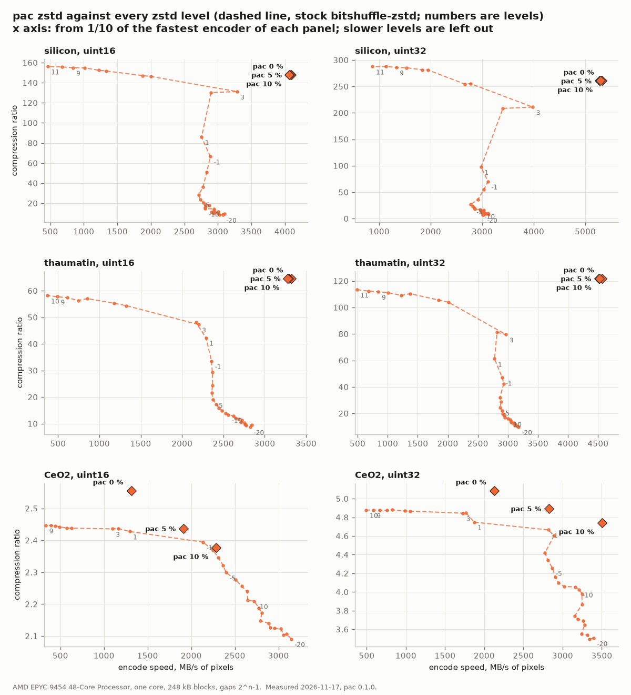
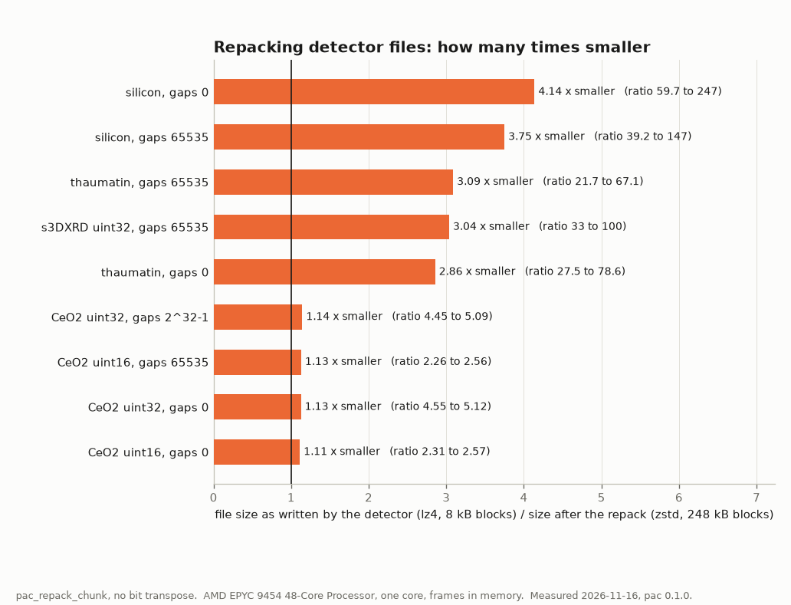
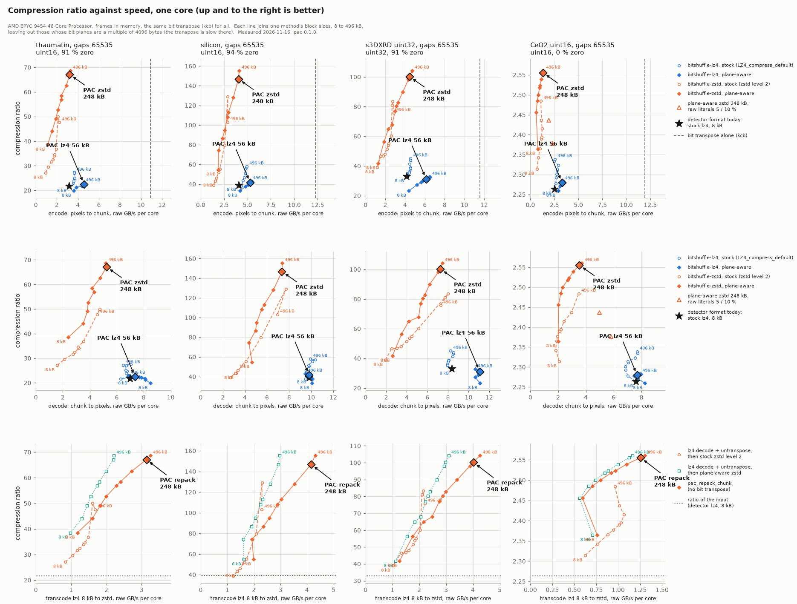

# pac-zstd

**pac zstd**: a bit-plane-aware Zstandard encoder for the bitshuffle HDF5 chunk format (filter
32008), for photon-counting detector frames, and a repack from the detector's bitshuffle-lz4 to
bitshuffle-zstd without a bit transpose.

**The files are ordinary bitshuffle-zstd.**  hdf5plugin, the bitshuffle filter,
dectris/compression and bslz4_to_sparse read them unchanged.  Only the encoder is new.

- **Zstandard at the speed of LZ4**: on sparse frames, files 3 to 4 times smaller than the
  bitshuffle-lz4 (8 kB blocks) that detectors write today, at about the same speed on one core.
- **Repacking detector files** from lz4 (8 kB) to zstd (248 kB) needs no bit transpose: up to
  twice as fast as decoding and writing stock zstd, with smaller files (table below).
- **Against stock zstd level 2** with the same bit transpose: 1.1 to 1.9 times faster, 12 to 25 %
  smaller on sparse frames, 5 % on dense ones.
- One C file in the C89 subset, with SSE2, AVX2, AVX-512, VSX and NEON kernels.
- The same parser can also write bitshuffle-lz4 ("pac lz4": 1.1 to 1.5 times faster than stock
  lz4, but with a 1 to 20 % lower ratio).  It is there, but it is not a big win.

## Against every zstd level

No zstd level is both faster and smaller than pac zstd on any of these frames: pac moves the
ratio-speed frontier of bitshuffle-zstd.  On dense frames it is smaller than every level, up to 22;
on sparse ones it is faster than every level.



The dashed line is stock bitshuffle-zstd (kcb transpose, then `ZSTD_compressCCtx`) at every level from
-20 to 22, 248 kB blocks; the diamonds are pac zstd with `pac_set_raw_literals` at 0, 5 and 10 %.  One
core, detector gaps set to 2^n-1.  The speed axis is linear and starts at 1/10 of the fastest
encoder in each panel; the slower levels are in the table.  On the dense CeO2 frames pac 0 % is both smaller and faster than
the highest levels: ratio 2.56 against 2.53 for levels 15 to 22 (uint16), at 1313 MB/s
against 9 to 40 MB/s.  On the sparse frames (silicon, thaumatin) it is faster than every level, 3300
to 5300 MB/s, but not the smallest: it sits near levels 3 to 9, and level 22 is 4 to 21 % smaller at
7 to 27 MB/s.  Raw literals at 5 and 10 % trade 4 to 7 % of ratio on CeO2 for 1.5 to 1.7 times the speed, and
change nothing on the sparse frames.  On dense data the negative levels can be faster than
pac 10 %: for uint16 CeO2, levels -20 and -5 run at 3145 and 2399 MB/s against 2288 MB/s,
with ratios 12 and 3 % lower; for uint32 CeO2, level -20 is 3 % slower than pac 10 %, with a 26 % lower ratio.  Cells are ratio, encode MB/s of pixels.

| encoder | silicon uint16 | silicon uint32 | thaumatin uint16 | thaumatin uint32 | CeO2 uint16 | CeO2 uint32 |
|---|---:|---:|---:|---:|---:|---:|
| pac 0 % | 148, 4092 | 261, 5321 | 64.6, 3319 | 122, 4564 | 2.56, 1313 | 5.09, 2126 |
| pac 5 % | 148, 4072 | 261, 5274 | 64.6, 3288 | 122, 4517 | 2.44, 1913 | 4.89, 2829 |
| pac 10 % | 148, 4066 | 261, 5296 | 64.6, 3274 | 122, 4520 | 2.38, 2288 | 4.74, 3501 |
| zstd -20 | 8.5, 3072 | 7.2, 3025 | 8.81, 2824 | 9.89, 3172 | 2.09, 3145 | 3.51, 3396 |
| zstd -5 | 23.9, 2736 | 23.1, 2820 | 19.0, 2377 | 24.5, 2869 | 2.3, 2399 | 4.26, 2869 |
| zstd -1 | 66.5, 2888 | 70.2, 3111 | 33.6, 2356 | 47.0, 2906 | 2.39, 2135 | 4.67, 2817 |
| zstd 1 | 85.9, 2757 | 97.6, 2978 | 42.3, 2290 | 61.2, 2777 | 2.43, 1294 | 4.75, 1871 |
| zstd 2 | 130, 2899 | 208, 3401 | 48.1, 2167 | 81.2, 2820 | 2.44, 1167 | 4.85, 1765 |
| zstd 3 | 131, 3285 | 211, 3979 | 47.3, 2200 | 79.6, 2968 | 2.44, 1096 | 4.84, 1726 |
| zstd 9 | 155, 837 | 286, 1333 | 57.8, 491 | 112, 844 | 2.45, 333 | 4.88, 583 |
| zstd 15 | 176, 111 | 311, 204 | 66.4, 87 | 127, 171 | 2.53, 40 | 5.02, 82 |
| zstd 19 | 181, 31 | 324, 59 | 66.7, 22 | 129, 43 | 2.53, 14 | 5.04, 24 |
| zstd 22 | 183, 14 | 329, 27 | 67.2, 7 | 130, 14 | 2.53, 9 | 5.04, 14 |

Rerun: `python3 bench/levels.py --core N`, then `python3 bench/plot_levels.py` (numbers in
`bench/results/levels.json`).

## Transcoding detector files: lz4 (8 kB) to zstd (248 kB)

One core of an AMD EPYC 9454, chunks in memory.  The input is each frame as the detector writes
it (bitshuffle-lz4, 8 kB blocks).  "pac zstd" is `pac_repack_chunk`; "zstd-2" is the lz4 decoded
and written again with stock zstd level 2, for comparison.  GB/s is the transcode speed in
uncompressed pixels; fps (frames/s) is for the detector of that data set (Eiger2 4M or 16M).

**Gaps and bad pixels set to 0:**

<table>
<tr><th rowspan="2" align="left">frames</th><th rowspan="2" align="center">lz4 8 kB<br>ratio (input)</th><th colspan="3" align="center">pac zstd 248 kB</th><th colspan="3" align="center">zstd-2 248 kB</th></tr>
<tr><th>ratio</th><th>GB/s/core</th><th>fps/core</th><th>ratio</th><th>GB/s/core</th><th>fps/core</th></tr>
<tr><td>silicon (4M, uint16)</td><td align="right"><code>59.73</code></td><td align="right"><code>247.10</code></td><td align="right"><code>4.57</code></td><td align="right"><code>511</code></td><td align="right"><code>188.59</code></td><td align="right"><code>2.30</code></td><td align="right"><code>257</code></td></tr>
<tr><td>thaumatin (16M, uint16)</td><td align="right"><code>27.54</code></td><td align="right"><code>78.64</code></td><td align="right"><code>3.18</code></td><td align="right"><code>88</code></td><td align="right"><code>62.93</code></td><td align="right"><code>1.60</code></td><td align="right"><code>44</code></td></tr>
<tr><td>CeO2 powder (4M, uint16)</td><td align="right"><code>2.31</code></td><td align="right"><code>2.57</code></td><td align="right"><code>1.35</code></td><td align="right"><code>151</code></td><td align="right"><code>2.45</code></td><td align="right"><code>1.03</code></td><td align="right"><code>116</code></td></tr>
<tr><td>CeO2 powder (4M, uint32)</td><td align="right"><code>4.55</code></td><td align="right"><code>5.12</code></td><td align="right"><code>2.14</code></td><td align="right"><code>120</code></td><td align="right"><code>4.89</code></td><td align="right"><code>1.50</code></td><td align="right"><code>84</code></td></tr>
</table>

**Gaps and bad pixels at the type's maximum** (as detectors write them):

<table>
<tr><th rowspan="2" align="left">frames</th><th rowspan="2" align="center">lz4 8 kB<br>ratio (input)</th><th colspan="3" align="center">pac zstd 248 kB</th><th colspan="3" align="center">zstd-2 248 kB</th></tr>
<tr><th>ratio</th><th>GB/s/core</th><th>fps/core</th><th>ratio</th><th>GB/s/core</th><th>fps/core</th></tr>
<tr><td>silicon (4M, uint16)</td><td align="right"><code>39.18</code></td><td align="right"><code>146.84</code></td><td align="right"><code>4.16</code></td><td align="right"><code>465</code></td><td align="right"><code>129.08</code></td><td align="right"><code>2.31</code></td><td align="right"><code>258</code></td></tr>
<tr><td>thaumatin (16M, uint16)</td><td align="right"><code>21.74</code></td><td align="right"><code>67.10</code></td><td align="right"><code>3.10</code></td><td align="right"><code>86</code></td><td align="right"><code>50.04</code></td><td align="right"><code>1.61</code></td><td align="right"><code>45</code></td></tr>
<tr><td>CeO2 powder (4M, uint16)</td><td align="right"><code>2.26</code></td><td align="right"><code>2.56</code></td><td align="right"><code>1.24</code></td><td align="right"><code>139</code></td><td align="right"><code>2.44</code></td><td align="right"><code>1.01</code></td><td align="right"><code>113</code></td></tr>
<tr><td>CeO2 powder (4M, uint32)</td><td align="right"><code>4.45</code></td><td align="right"><code>5.09</code></td><td align="right"><code>2.15</code></td><td align="right"><code>120</code></td><td align="right"><code>4.85</code></td><td align="right"><code>1.54</code></td><td align="right"><code>86</code></td></tr>
<tr><td>s3DXRD scan (4M, uint32)</td><td align="right"><code>33.03</code></td><td align="right"><code>100.27</code></td><td align="right"><code>4.02</code></td><td align="right"><code>225</code></td><td align="right"><code>83.47</code></td><td align="right"><code>2.14</code></td><td align="right"><code>120</code></td></tr>
</table>



Threads, network links, 8-bit frames: [docs/benchmarks.md](docs/benchmarks.md).

## Ratio against speed



Each line is one method at block sizes from 8 kB to 496 kB; the arrows mark the defaults.  "Stock" is
`LZ4_compress_default` or zstd level 2 on each block after the same bit transpose; the star is
stock lz4 with 8 kB blocks, the format detectors write today.

- **Encode**: the bit transpose alone (dashed line) runs at 11 to 12 GB/s, 2 to 9 times faster
  than the plane-aware zstd encoder: most of the time goes into the parse and zstd's entropy
  coding (Huffman), above all on dense frames.
- **Decode** (the stock decoders): plane-aware zstd chunks decode at 3.5 to 8 GB/s, 0.9 to 1.3
  times the speed of stock zstd level 2 chunks; the detector's lz4 decodes up to 2 times faster
  (on dense frames).
- **Transcode**: the repack is 1.1 to 1.4 times faster than decoding and encoding again with the
  plane-aware encoder (same output), and 1.2 to 2 times faster than decoding and writing stock zstd level 2,
  whose files are 5 to 34 % larger.

## How it works

After the bit transpose, a block of pixels is a stack of bit planes.  For counting detectors the
planes are empty (or a copy of the plane below), sparse (mostly zero bytes), or noise.  LZ4 and
zstd search for repeats with hash tables; here a repeat is either a run of equal bytes (offset 1)
or the same bytes as the plane before (offset = one plane length).  The encoder tests those two
offsets and nothing else, in one pass with SIMD compares.

- **Zstandard output**: the parse goes to `ZSTD_compressSequences()`, which does only the entropy
  coding, one zstd block (one Huffman table) per plane that holds literals.
- **LZ4 output** (pac lz4): the same sequences are written out as LZ4 blocks instead.
- **Repack**: bit plane k of a large block is the planes k of the small blocks it is made of, one
  after the other, so each 8 kB lz4 block is decoded and its plane slices copied into place.
- **Narrow transpose**: if the upper bytes of every pixel in a block are zero, only the lower bytes
  are transposed.  The output is identical.

## Use

    git submodule update --init
    make              # build/libpac.a and build/libpac.so, with lz4, zstd and kcb inside
    make check        # round trips on every instruction set this CPU has

The library has two jobs, both producing one HDF5 chunk in the bitshuffle format (filter 32008):

- `pac_compress_chunk`: **pixels to chunk**.  Bit transpose, then plane-aware zstd (or lz4),
  block by block.  Use it where frames are written (or with `H5Dwrite_chunk` from your own code).
- `pac_repack_chunk`: **chunk to chunk**.  Takes a bitshuffle chunk as stored (e.g. by a
  detector: lz4, 8 kB blocks) and writes it again with the encoder's codec and a larger block,
  without a bit transpose.  Use it to shrink existing files or a detector stream.

```c
#include "pac.h"

pac_encoder *enc = pac_create(PAC_ZSTD);      /* (PAC_LZ4 for pac lz4) the output codec.  One per thread;
                                                 it keeps its buffers between calls. */
/* pixels to chunk */
size_t cap = pac_bound(nbytes, 2, PAC_ZSTD_BLOCK);    /* largest possible chunk */
size_t n = pac_compress_chunk(enc,
                              chunk, cap,      /* output buffer and its size */
                              pixels, nbytes,  /* the pixels of the chunk, size in bytes */
                              2,               /* bytes per pixel: 1, 2, 4 or 8 */
                              PAC_ZSTD_BLOCK); /* block size in bytes, a multiple of 8 x that */
if (n == 0) { /* error: bad arguments or cap too small */ }
/* chunk[0..n) is what H5Dwrite_chunk / h5py's write_direct_chunk take, for a dataset created
   with hdf5plugin.Bitshuffle(nelems=PAC_ZSTD_BLOCK // 2, cname="zstd") */

/* chunk to chunk: cap from pac_bound of the pixel size, which is the first 8 bytes
   (big-endian) of every bitshuffle chunk */
n = pac_repack_chunk(enc,
                     chunk, cap,               /* output buffer and its size */
                     lz4_chunk, lz4_size,      /* the stored chunk */
                     PAC_LZ4,                  /* codec of its blocks: PAC_LZ4 or PAC_ZSTD */
                     2,                        /* bytes per pixel */
                     PAC_ZSTD_BLOCK);          /* new block size: a multiple of the old one */
pac_free(enc);
```

Options (each only trades speed against size; any reader reads the result):
`pac_set_raw_literals(enc, percent)` skips Huffman coding of literals that would shrink less than
`percent` %: 5 or 10 encode dense frames 1.4 to 1.9 times faster for 4 to 7 % of ratio.
`pac_set_narrow` and `pac_set_transpose` control the bit transpose.  **[src/pac.h](src/pac.h) is
the reference for every call.**  To build it into another code base, see
[docs/build.md](docs/build.md).

## To do

- **A way to repack files without writing code.**  A small Python package (ctypes on `libpac`)
  with `python -m pac repack in.h5 out.h5`: stored bitshuffle chunks in, bitshuffle-zstd 248 kB
  chunks out, everything else copied; `bench/check_files.py` and `bench/bench_repack.py` moved onto
  it.  Or through `h5repack`, which would need the encoder as an HDF5 filter plugin for 32008;
  that id is bitshuffle's, so this belongs upstream (bitshuffle, hdf5plugin) rather than as a
  second plugin.  Either way, supporting every HDF5 layout (external links, virtual datasets,
  master files) is the hard part.
- **An entropy coder tuned to diffraction data.**  The literals left after the parse are bit
  planes of photon counts, close to Poisson statistics, plus Bragg peaks and rings.  Today zstd's
  general-purpose Huffman stage is the price of the small files (the raw-literal option trades it
  away).  A coder that knows the statistics (per-plane bit densities, neighbouring pixels, the
  previous frame) could be both smaller and faster; learning such a model from the large public
  archives of detector frames is an AI/ML project looking for funding.
- **An entropy stage of our own for zstd**, in place of `ZSTD_compressSequences`.  On dense frames
  about 40 % of the Huffman time is counting literal bytes and 16 % building the table.  A bit
  plane of photon counts is close to independent bits, so its table could be chosen from the
  plane's bit density among a few precomputed ones.  Estimated cost: 1 to 2 % more literal bytes
  on noisy frames (CeO2); not for structured planes (it would double thaumatin's literals).  zstd
  has no call that accepts a table, so this means writing the literal and sequence sections of
  the zstd block ourselves; the decoders stay stock.
- All-zero blocks as a zstd RLE block (an empty frame costs twice what stock zstd needs).
- NEON on ARM hardware; a 32-bit ARM NEON kernel; SIMD for the narrow-transpose packing off x86.
- A GPU encoder: the parse is two compares and a prefix scan, and the LZ4 output can be laid out
  with a prefix sum.

What is tested and the known limits: [docs/benchmarks.md](docs/benchmarks.md#status).

## Related work from the human

This repository addresses one question: how to write bitshuffle-zstd faster, so that sparse frames
can be stored 3 to 4 times smaller at lower cost.  The earlier work was about reading the existing
data in the bitshuffle-lz4 (bslz4) format:

- [bslz4decoders](https://github.com/jonwright/bslz4decoders): decoding bitshuffle-lz4 on CPU and
  GPU; notes on the [chunk format](https://github.com/jonwright/bslz4decoders/blob/main/doc/about_bslz4.md)
  and the [bit transpose](https://github.com/jonwright/bslz4decoders/blob/main/doc/shuffle_notes.md).
- J. Wright, "Experiences with GPU decompression for bitshuffle + LZ4 data", European HDF5 Users
  Group meeting, 2021: [video](https://www.youtube.com/watch?v=wVV6mwx29dI),
  [slides](https://www.hdfgroup.org/wp-content/uploads/2021/07/Jon_Wright_bslz4decoders.pdf).
- J. Wright, "Using Sparse Arrays for Synchrotron 3D-XRD-CT Data Reduction", European HDF User
  Group summit, DESY, 20 September 2023:
  [abstract and slides](https://indico.desy.de/event/39343/contributions/152275/).
- [bslz4_to_sparse](https://github.com/jonwright/bslz4_to_sparse): chunks straight to sparse
  pixels and azimuthal integrals, with a plane-aware *decoder*.  The ID11 data sets used here are
  its examples.

## Credits and references

Jon Wright (ESRF, beamline ID11) asked the questions, pointed to the data and code, and reviewed
the results.  Claude (Anthropic: Fable 5.2, with Opus 5.5 and Sonnet 5.5) contributed ideas as
well as the code, tests, measurements and documentation, on a seat provided by ESRF.

This is an encoder for other people's format, built on other people's code.  Please cite them:

1. The bitshuffle filter and its HDF5 chunk format: K. Masui et al.,
   https://github.com/kiyo-masui/bitshuffle; K. Masui et al., "A compression scheme for radio data
   in high performance computing", Astronomy and Computing 12, 181-190 (2015),
   https://doi.org/10.1016/j.ascom.2015.07.002
2. DECTRIS, whose detectors write bitshuffle-lz4 and made it the common format for diffraction
   frames: the SIMD bit transpose used here ("kcb"), K. Conley,
   https://github.com/kalcutter/bitshuffle; and https://github.com/dectris/compression.
3. LZ4, Y. Collet, https://github.com/lz4/lz4
4. Zstandard, Y. Collet and Meta Platforms, https://github.com/facebook/zstd
5. H. J. Bernstein and J. Jakoncic, "Investigation of fast and efficient lossless compression
   algorithms for macromolecular crystallography experiments", J. Synchrotron Rad. 31, 647-654
   (2024), https://doi.org/10.1107/S160057752400359X
6. TERSE/PROLIX, a different approach to the same frames (bit packing in the pixel domain):
   S. Matinyan and J. P. Abrahams, "TERSE/PROLIX (TRPX) - a new algorithm for fast and lossless
   compression and decompression of diffraction and cryo-EM data", Acta Cryst. A79, 536-541
   (2023), https://doi.org/10.1107/S205327332300760X; code: https://github.com/senikm/trpx2.0
7. hdf5plugin, which makes the filters available to h5py and reads the chunks back in the
   benchmarks: https://github.com/silx-kit/hdf5plugin

MIT licence.
